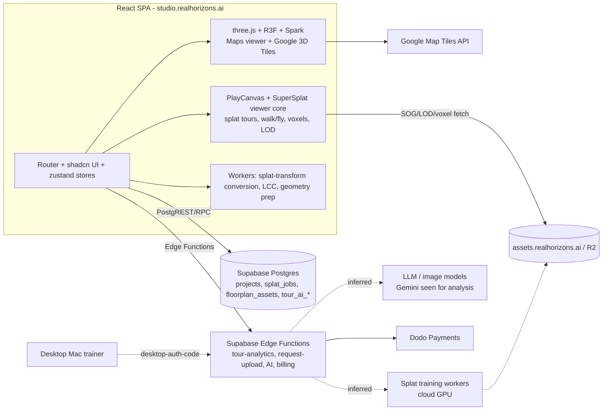

# Architecture report

Confidence: Verified / Strongly supported / Inferred / Unknown.

## Frontend
- React SPA, react-router, Vite with the Rolldown bundler, ~314 lazy chunks. **Verified** (globals, modulepreload list).
- UI: Radix/shadcn-style primitives (`sidebar`, `sheet`, `tooltip` chunks), lucide icons, sonner toasts, Plus Jakarta Sans. **Strongly supported**
- State: per-domain stores (`simpleEditor.store`, `splat3d.store`, `map.store`), with zustand present in the bundles. **Strongly supported**
- Konva (floor-plan/2D canvas likely), jsPDF and pdf.js (PDF export/import), i18n viewer languages (`viewerLanguage` chunk). **Inferred** for exact usage.

## Graphics (two engines)
1. **PlayCanvas engine + SuperSplat viewer core** for splat tours (`PlayCanvasSplatViewer`, `splat-viewer-core`, `SuperSplatEditor`, `dist-*` containing the playcanvas/supersplat-viewer sources, a `webgpu-graphics-device` chunk). Strongly supported.
2. **three.js + react-three-fiber + Spark** (`SparkRenderer`, `PackedSplats`, `SplatMesh`) and **3DTilesRenderer** for the Maps viewer (Google Photorealistic Tiles plus an optional splat on the map). three-mesh-bvh is used in real-estate and tour code for geometry raycasting. Strongly supported.
- Map engine: maplibre-gl for 2D neighbourhood maps. Strongly supported.
- Conversion workers: `splatDownloadConversion.worker` and `lccConversion.worker` (XGRIDS LCC to splat), using playcanvas/splat-transform. Strongly supported.

## Backend
- **Supabase** (project ref visible in requests): Postgres via PostgREST tables and ~45 RPCs, Auth (Google OAuth), Edge Functions (~30). Verified for 3 runtime calls; the rest is static evidence.
- Assets: `assets.realhorizons.ai` (Cloudflare R2/CDN) plus a public `*.r2.dev` bucket. Uploads use `request-upload` / `request-splat-upload` and `finalize_storage_upload` / `abort_storage_upload` (presigned direct-to-R2 likely). Verified hosts; flow Inferred.
- Splat training: a cloud job queue (`splat_jobs`, queue position/depth, billing quote) plus a local Mac app (`/desktop/login`, `desktop-auth-code`). Strongly supported. Training stack Unknown.
- AI: edge functions and a "tour-ai-gateway". One Gemini model id is embedded for session analysis. Reframe/Spatial Sense providers are Unknown.
- Billing: Dodo Payments (edge functions), credits ledger. Strongly supported.
- Observability: Sentry, Microsoft Clarity, GA4, Cloudflare Web Analytics. Verified.

## Diagram

Dashed edges are inferred.
